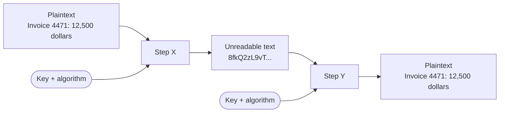
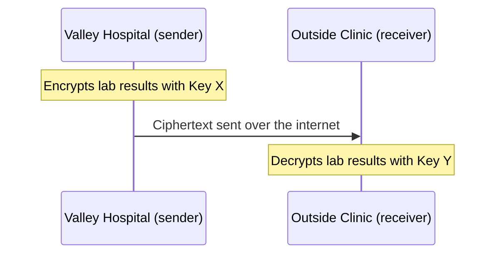
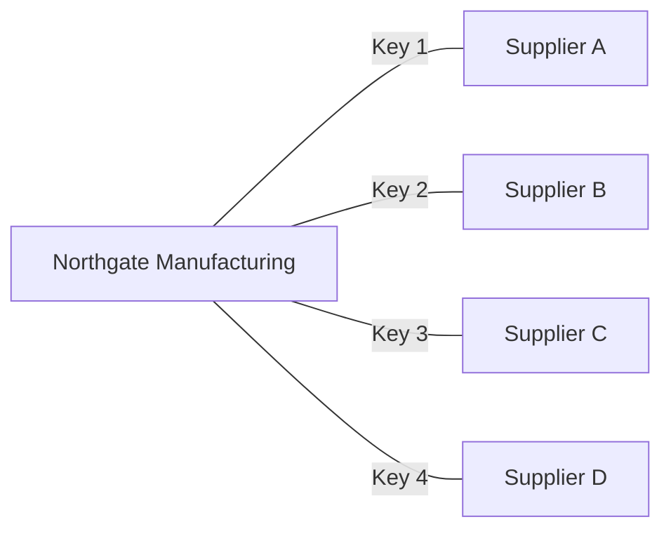
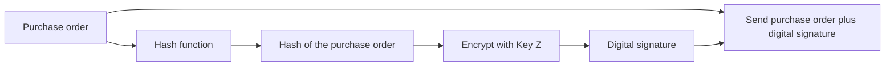
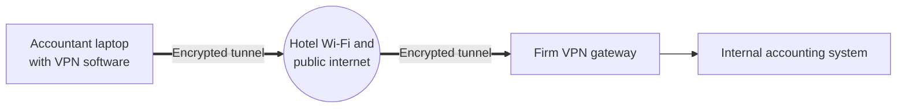
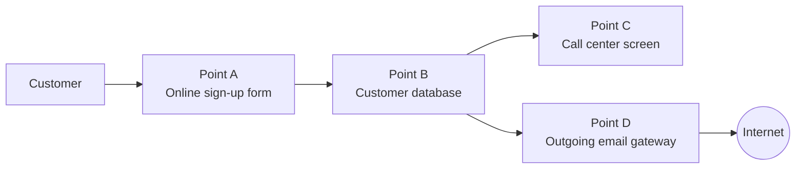
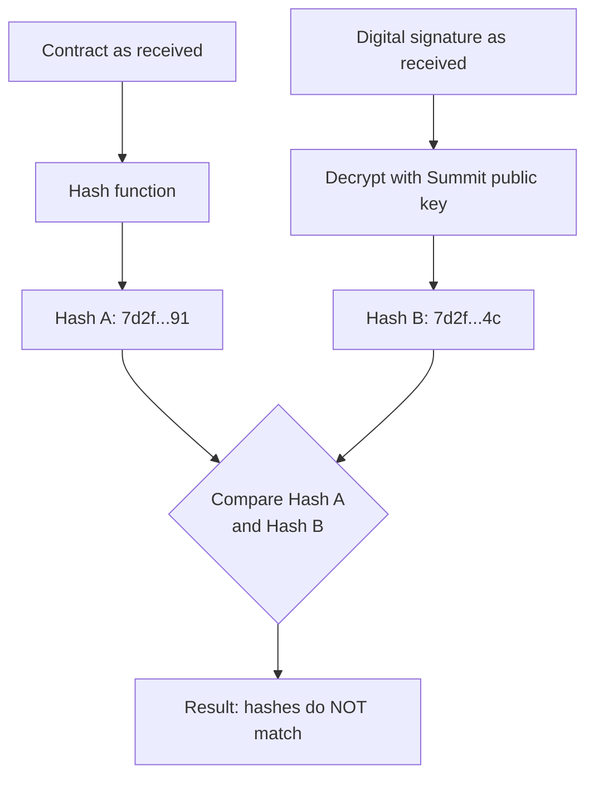
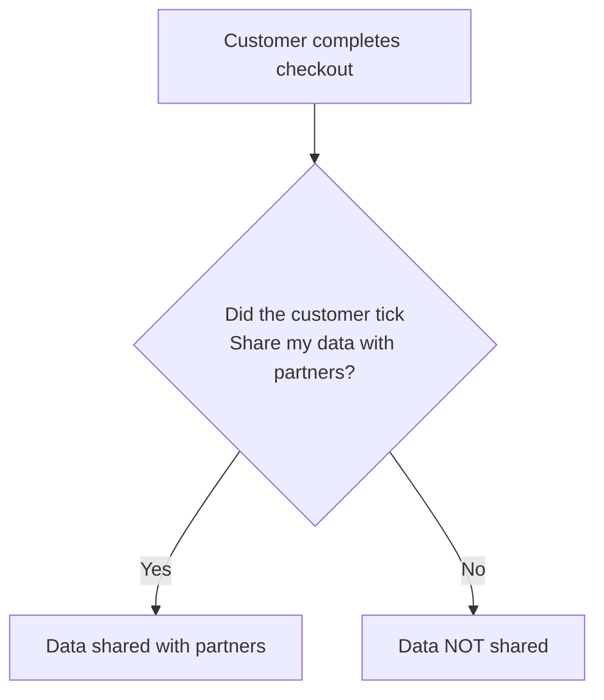

# Confidentiality and Privacy Controls: Practice Questions

Practice questions for the *Confidentiality and Privacy Controls* lecture, in two parts: **15 case-based questions** and **8 diagram-based questions**. Each question describes a realistic business situation and asks you to pick the best control, principle, or explanation. Answers and short explanations are hidden under **Show answer** so you can test yourself first.

## Learning Objectives

After working through the questions, you should be able to:

1. Identify and explain controls that protect the **confidentiality** of sensitive information.
2. Identify and explain controls that protect the **privacy** of customers' personal information.
3. Explain how the two basic types of **encryption** systems (symmetric and asymmetric) work.

## How to Use

1. Read each case and choose an answer before expanding **Show answer**.
2. Check your score with the answer key at the end of each part.
3. The diagrams in Part 2 are written in Mermaid, which GitHub draws automatically when you view this file on github.com.

## Contents

**[Part 1: Case-Based Questions](#part-1-case-based-questions)**

- [Case 1: Two kinds of sensitive data](#case-1-two-kinds-of-sensitive-data)
- [Case 2: Where is it and who can see it?](#case-2-where-is-it-and-who-can-see-it)
- [Case 3: The policy came too late](#case-3-the-policy-came-too-late)
- [Case 4: The pre-ticked box](#case-4-the-pre-ticked-box)
- [Case 5: Too much information](#case-5-too-much-information)
- [Case 6: A new use for old data](#case-6-a-new-use-for-old-data)
- [Case 7: "Fix my address"](#case-7-fix-my-address)
- [Case 8: The call center sees too much](#case-8-the-call-center-sees-too-much)
- [Case 9: Who leaked the blueprint?](#case-9-who-leaked-the-blueprint)
- [Case 10: The customer list goes home](#case-10-the-customer-list-goes-home)
- [Case 11: Read, but don't forward](#case-11-read-but-dont-forward)
- [Case 12: One key, fifty suppliers](#case-12-one-key-fifty-suppliers)
- [Case 13: Buying a book online](#case-13-buying-a-book-online)
- [Case 14: Encrypted, but still breached](#case-14-encrypted-but-still-breached)
- [Case 15: "I never approved that"](#case-15-i-never-approved-that)
- [Answer Key: Part 1](#answer-key-part-1)

**[Part 2: Diagram-Based Questions](#part-2-diagram-based-questions)**

- [Diagram Case 1: Fill in the encryption steps](#diagram-case-1-fill-in-the-encryption-steps)
- [Diagram Case 2: Which keys are X and Y?](#diagram-case-2-which-keys-are-x-and-y)
- [Diagram Case 3: One key per supplier](#diagram-case-3-one-key-per-supplier)
- [Diagram Case 4: Creating a digital signature](#diagram-case-4-creating-a-digital-signature)
- [Diagram Case 5: Working from a hotel](#diagram-case-5-working-from-a-hotel)
- [Diagram Case 6: Match the control to the point](#diagram-case-6-match-the-control-to-the-point)
- [Diagram Case 7: The hashes don't match](#diagram-case-7-the-hashes-dont-match)
- [Diagram Case 8: Opt-in or opt-out?](#diagram-case-8-opt-in-or-opt-out)
- [Answer Key: Part 2](#answer-key-part-2)

---

# Part 1: Case-Based Questions

## Case 1: Two kinds of sensitive data

Brightline Foods keeps two databases on the same server. One holds the secret recipes and supplier cost agreements for its best-selling sauces. The other holds the names, home addresses, and birthdays of 40,000 loyalty-card members. The IT manager says, "Both are just confidential data, so one policy covers both."

Which statement best describes the two databases?

- A. Both databases fall under privacy because they contain sensitive data.
- B. The recipe database is a confidentiality concern; the loyalty-card database is a privacy concern.
- C. The recipe database is a privacy concern; the loyalty-card database is a confidentiality concern.
- D. Neither needs protection unless it is transmitted over the internet.

<strong>Show answer</strong>

**Answer: B**

Confidentiality protects the organization's own intellectual property, such as trade secrets, strategic plans, cost information, and legal documents. Privacy protects personal information about customers, employees, vendors, and business partners. The IT manager is wrong to treat them as one category, because privacy brings extra obligations (such as the Generally Accepted Privacy Principles) that do not apply to trade secrets. Option D is wrong because data must be protected both in storage and in transit.

---

## Case 2: Where is it and who can see it?

After a near-miss, the CFO of Harmon Medical Supply wants to "encrypt everything right away." The internal auditor says that step comes too early.

What should the company do **first**?

- A. Buy the strongest encryption software available.
- B. Identify where sensitive information is located, who has access to it, and classify it by its value to the organization.
- C. Run a security awareness training session.
- D. Install digital watermarks on all documents.

<strong>Show answer</strong>

**Answer: B**

The first step in protecting confidentiality and privacy is to identify and classify the information. The company needs to know where sensitive data lives, who has access, and how valuable it is before it can decide which controls (encryption, access controls, masking, and so on) each kind of data needs. Encrypting "everything" without classification wastes resources and can miss data stored in unexpected places.

---

## Case 3: The policy came too late

A fitness app asks new users for their weight, location, and daily step data during sign-up. The link to its privacy policy appears only on the confirmation screen, after the account has been created and the data has been saved.

Which Generally Accepted Privacy Principle (GAPP) is most clearly violated?

- A. Notice
- B. Security
- C. Quality
- D. Monitoring and enforcement

<strong>Show answer</strong>

**Answer: A. Notice**

The Notice principle requires an organization to tell people about its privacy policies and practices **before** it collects their data. Showing the policy after the data is already captured defeats the purpose, because users could not make an informed decision about whether to share it.

---

## Case 4: The pre-ticked box

An online clothing retailer's checkout page includes a box that is already checked: "Yes, share my information with our marketing partners." Customers must notice it and uncheck it to avoid having their data shared.

Which GAPP principle is involved, and what approach is the retailer using?

- A. Collection; an opt-in approach
- B. Choice and consent; an opt-out approach
- C. Choice and consent; an opt-in approach
- D. Access; an opt-out approach

<strong>Show answer</strong>

**Answer: B**

Choice and consent is about giving people a real choice over how their information is used. In an **opt-out** approach, sharing happens by default unless the customer acts to stop it, which is what a pre-checked box does. In an **opt-in** approach, nothing is shared unless the customer actively agrees. Opt-in gives customers stronger privacy protection.

---

## Case 5: Too much information

A local gym's membership form asks for name, phone number, emergency contact, Social Security number, mother's maiden name, and annual income. The gym only needs to bill a monthly fee to a card.

Which GAPP principle does this form violate most directly?

- A. Use and retention
- B. Disclosure to third parties
- C. Collection
- D. Management

<strong>Show answer</strong>

**Answer: C. Collection**

The Collection principle says an organization should collect only the information it needs for the purposes described in its privacy policy. A gym has no business need for a Social Security number, mother's maiden name, or income. Collecting extra data also increases risk: if the gym is breached, it exposes exactly the details identity thieves look for.

---

## Case 6: A new use for old data

Coastal Pharmacy collected customer phone numbers so it could text prescription-ready alerts. Two years later, the pharmacy starts selling the list to a vitamin company and keeps the numbers of customers who have not visited in five years.

Which GAPP principle is most directly violated?

- A. Use and retention
- B. Notice
- C. Quality
- D. Security

<strong>Show answer</strong>

**Answer: A. Use and retention**

Use and retention requires that personal information be used only for the business purpose stated when it was collected, and kept only as long as needed for that purpose. Selling numbers collected for prescription alerts is a new, unstated use, and holding data on long-inactive customers goes beyond any reasonable retention need. (Selling the list also raises the **Disclosure to third parties** principle.)

---

## Case 7: "Fix my address"

A customer notices that her bank's online profile lists an old address and a misspelled name. When she calls to fix it and asks to see what else the bank holds on her, the representative says, "Customers can't view or edit internal records."

Which GAPP principle is the bank failing to meet?

- A. Collection
- B. Access
- C. Compliance
- D. Choice and consent

<strong>Show answer</strong>

**Answer: B. Access**

The Access principle says customers should be able to review, correct, and, where appropriate, delete the information an organization collects about them. Letting customers correct their own records also supports the **Quality** principle, because it keeps personal data accurate.

---

## Case 8: The call center sees too much

At an insurance company's call center, representatives verify callers by asking for the last four digits of their Social Security number. However, the screen displays every caller's full nine-digit number, birthdate, and full bank account number.

Which control would best reduce the privacy risk while still letting representatives verify callers?

- A. Digital watermarking
- B. Symmetric encryption of the call recordings
- C. Data masking
- D. A virtual private network

<strong>Show answer</strong>

**Answer: C. Data masking**

Data masking replaces sensitive personal data with characters such as `XXX-XX-1234`, so users see only what they need for their job. Representatives can still verify the last four digits, but they cannot copy the full number. Data masking is listed in the lecture as a **privacy** control. Encryption (B) protects data in storage or transit, but once data is decrypted and displayed on screen, masking is what limits exposure.

---

## Case 9: Who leaked the blueprint?

An engineering firm sends draft blueprints of a new product to five outside contractors. A month later, one blueprint appears on a competitor's website. Management wants to find out which contractor leaked it and to deter future leaks.

Which control would have helped most?

- A. Data masking
- B. Digital watermarks
- C. Opt-in consent
- D. Hashing the file names

<strong>Show answer</strong>

**Answer: B. Digital watermarks**

A digital watermark is an embedded code that identifies a document as the organization's property, and it can be made unique to each recipient. If each contractor's copy carried its own watermark, the leaked copy would point back to its source. Watermarks are a **detective** control for confidentiality: they do not stop the leak, but they identify where it came from and discourage it.

---

## Case 10: The customer list goes home

A departing salesperson at a software company tries to email the full customer contact list, which includes pricing terms, to his personal Gmail account the day before he quits.

Which control is specifically designed to catch and block this kind of outgoing transmission?

- A. Data loss prevention (DLP) software
- B. A digital certificate
- C. Key escrow
- D. Data masking

<strong>Show answer</strong>

**Answer: A. Data loss prevention (DLP)**

Controlling outgoing information is a key confidentiality control. DLP software scans outgoing email, instant messages, and other transmissions for keywords or patterns that indicate protected data, and blocks or flags them. It is a **preventive** control, while a digital watermark would be detective. Neither key escrow nor digital certificates monitor outgoing messages.

---

## Case 11: Read, but don't forward

A company's board of directors receives confidential merger documents electronically. The chair wants directors to be able to read the files but not print, copy, or forward them, and wants access to expire after the vote.

Which control fits best?

- A. Spam filtering
- B. Information rights management (IRM)
- C. Data masking
- D. Asymmetric encryption alone

<strong>Show answer</strong>

**Answer: B. Information rights management (IRM)**

IRM software controls what authorized users can do with a document after they open it: whether they can read, copy, print, forward, or download it, and for how long. Encryption alone (D) controls who can open the file, but once it is decrypted, the reader could copy or forward its contents. IRM adds the post-access restrictions the chair wants.

---

## Case 12: One key, fifty suppliers

Northgate Manufacturing uses symmetric encryption for purchase orders. To keep things simple, it gives the **same** secret key to all 50 of its suppliers.

What is the main weakness of this arrangement?

- A. Symmetric encryption is too slow for purchase orders.
- B. Any supplier holding the key could decrypt messages meant for the other 49 suppliers, and the key had to be distributed securely 50 times.
- C. Symmetric encryption cannot protect data in transit.
- D. Suppliers would need Northgate's private key to read messages.

<strong>Show answer</strong>

**Answer: B**

Symmetric encryption uses **one key** to both encrypt and decrypt, so everyone who has the key can read everything protected by it. With symmetric systems, each trading partner should get its own different key, and each key must be shared over a secure channel. A common way to avoid this burden is asymmetric encryption, where one public key can be given to all trading partners. Option D is wrong because symmetric systems do not use public and private key pairs.

---

## Case 13: Buying a book online

Maya buys a textbook from an online bookstore and enters her credit card number at checkout. The bookstore uses asymmetric encryption.

Which keys are used to protect her credit card information?

- A. Maya encrypts with her own private key; the bookstore decrypts with Maya's public key.
- B. Maya's browser encrypts with the bookstore's public key; the bookstore decrypts with its own private key.
- C. Maya's browser encrypts with the bookstore's private key; the bookstore decrypts with its public key.
- D. Both sides use the same shared secret key.

<strong>Show answer</strong>

**Answer: B**

In asymmetric encryption, anything encrypted with the recipient's **public key** can be decrypted only with the matching **private key**. The bookstore's public key is available to everyone, so any customer can use it, but only the bookstore, which holds the private key, can read the card number. Option C is impossible because the bookstore would never give out its private key. Option D describes symmetric encryption.

---

## Case 14: Encrypted, but still breached

A regional retailer encrypts all stored credit card numbers using a strong, modern algorithm with a long key. Hackers break into the database server and decrypt millions of card numbers anyway. Investigators find that the decryption key was stored in a file on that same server.

What was the main cause of the breach?

- A. The key length was too short.
- B. The algorithm was too weak.
- C. Poor key management: the key was not stored securely, apart from the data it protects.
- D. Symmetric encryption cannot protect stored data.

<strong>Show answer</strong>

**Answer: C**

Encryption strength depends on three factors: key length, the algorithm, and the **policies for managing keys**. A long key and a strong algorithm are worthless if the key sits next to the data, because an attacker who reaches the server gets both. This is a common reason hackers obtain card data despite encryption. Keys should be stored securely and separately from the data they protect.

---

## Case 15: "I never approved that"

The CFO of Summit Logistics emails the bank to approve a $250,000 wire transfer. After the deal goes badly, the CFO claims she never sent the approval. The email had been digitally signed.

How does the digital signature resolve the dispute?

- A. The bank decrypts the signature with the CFO's private key, proving the email was not changed.
- B. The CFO created the signature by encrypting a hash of the email with her private key; the bank verifies it with her public key. Because only she holds her private key, she cannot credibly deny sending it.
- C. The signature was created with the bank's public key, so only the bank could have sent it.
- D. Digital signatures only show that an email was encrypted, not who sent it.

<strong>Show answer</strong>

**Answer: B**

A digital signature is created by hashing a document and encrypting that hash with the signer's **private key**. Anyone can decrypt it with the signer's **public key** and compare it to a fresh hash of the document. A match proves two things: the document has not been altered (any change produces a different hash), and it came from the holder of that private key. This provides **nonrepudiation**, meaning the sender cannot deny having sent it. Digital signatures are one of the capabilities asymmetric encryption offers that symmetric encryption does not.

---

## Answer Key: Part 1

| Case | Answer | Topic |
|:---:|:---:|---|
| 1 | B | Confidentiality vs. privacy |
| 2 | B | Identify and classify information |
| 3 | A | GAPP: Notice |
| 4 | B | GAPP: Choice and consent (opt-out) |
| 5 | C | GAPP: Collection |
| 6 | A | GAPP: Use and retention |
| 7 | B | GAPP: Access |
| 8 | C | Data masking |
| 9 | B | Digital watermarks |
| 10 | A | Data loss prevention |
| 11 | B | Information rights management |
| 12 | B | Symmetric encryption key sharing |
| 13 | B | Asymmetric encryption (public/private keys) |
| 14 | C | Encryption strength and key management |
| 15 | B | Digital signatures and nonrepudiation |

---

# Part 2: Diagram-Based Questions

## Diagram Case 1: Fill in the encryption steps

An accounts payable clerk at Redwood Distributors sends an invoice to a customer. The diagram shows what happens to the invoice, but two steps are labeled **X** and **Y**.

Which labels correctly complete the diagram?

- A. X = Hashing, Y = Decryption
- B. X = Encryption performed by the sender, Y = Decryption performed by the receiver
- C. X = Decryption performed by the sender, Y = Encryption performed by the receiver
- D. X = Data masking, Y = Data unmasking

<strong>Show answer</strong>

**Answer: B**

Encryption takes **plaintext** and, using a key and an algorithm, turns it into unreadable **ciphertext**. This is done by the sender. Decryption uses a key to reverse the process and make the information readable again. This is done by the receiver. Hashing (A) is one-way, so the original invoice could never be recovered from it. Data masking (D) hides characters on a screen; it is not a reversible transformation for sending messages.

---

## Diagram Case 2: Which keys are X and Y?

Valley Hospital sends lab results to an outside clinic. The two organizations use asymmetric encryption.

Which keys are X and Y?

- A. X = Hospital's private key, Y = Hospital's public key
- B. X = Clinic's private key, Y = Clinic's public key
- C. X = Clinic's public key, Y = Clinic's private key
- D. X and Y are the same shared secret key

<strong>Show answer</strong>

**Answer: C**

To keep a message confidential with asymmetric encryption, the sender encrypts it with the **receiver's public key**. Only the receiver's matching **private key** can decrypt it. Anyone can have the clinic's public key, but only the clinic holds its private key, so only the clinic can read the lab results. Option A would let anyone with the hospital's public key read the message, so it gives no confidentiality. Option D describes symmetric encryption.

---

## Diagram Case 3: One key per supplier

Northgate Manufacturing uses symmetric encryption and gives each supplier its own key, as shown.

Which statement about this setup is correct?

- A. Each of the four keys must be delivered to its supplier over a secure channel; with asymmetric encryption, Northgate could instead publish one public key that all four suppliers use.
- B. Supplier A can read messages sent to Supplier B because both use symmetric encryption.
- C. Northgate should replace Keys 1 to 4 with a single key for all suppliers to make it more secure.
- D. Each supplier needs Northgate's private key to read its messages.

<strong>Show answer</strong>

**Answer: A**

Symmetric encryption uses one key to both encrypt and decrypt, so both parties must know it, and it has to be shared securely. Because one shared key would let every supplier read every other supplier's messages, each trading partner needs its own key, which is what the diagram shows. That means one more key to create, deliver, and protect for every new partner. Asymmetric encryption avoids this: one **public key** can be used by all trading partners, while Northgate keeps the **private key** secret. Option C would reintroduce the problem, and option D would give away the one key that must stay secret.

---

## Diagram Case 4: Creating a digital signature

Summit Logistics digitally signs every purchase order before sending it to a vendor.

What is **Key Z**, and which key will the vendor use to verify the signature?

- A. Key Z = Vendor's public key; the vendor verifies with its own private key.
- B. Key Z = A shared symmetric key; the vendor verifies with the same key.
- C. Key Z = Summit's public key; the vendor verifies with Summit's private key.
- D. Key Z = Summit's private key; the vendor verifies with Summit's public key.

<strong>Show answer</strong>

**Answer: D**

A digital signature is a hash of the document encrypted with the **signer's private key**. The vendor decrypts the signature with Summit's **public key** and compares it to a fresh hash of the purchase order. Because only Summit holds its private key, a valid signature proves Summit sent the order, which provides **nonrepudiation**. Option C would require the vendor to have Summit's private key, which must never be shared.

---

## Diagram Case 5: Working from a hotel

An accountant at Pine Street CPAs connects to the firm's accounting system from a hotel lobby.

An attacker on the same hotel Wi-Fi captures all traffic between the laptop and the firm. What will the attacker see?

- A. The client files in readable form, because hotel Wi-Fi is public.
- B. Nothing at all, because a VPN prevents any traffic from crossing the internet.
- C. Ciphertext only, because the VPN encrypts the data before it leaves the laptop and the firm's gateway decrypts it.
- D. Readable data, because a VPN only protects data in storage.

<strong>Show answer</strong>

**Answer: C**

A virtual private network securely sends encrypted data between a sender and a receiver that hold the right encryption and decryption keys. The data still travels across the public internet (so B is wrong), but it is encrypted in transit, so the attacker captures only unreadable ciphertext. It is decrypted at the firm's VPN gateway. Option D is wrong because protecting data **in transit** is exactly what a VPN does.

---

## Diagram Case 6: Match the control to the point

The diagram shows how customer data moves through Brightline Insurance. Four control points are marked A to D.

Which set of controls best matches each point?

- A. A = Privacy notice and consent, B = Encryption of stored data, C = Data masking, D = Data loss prevention
- B. A = Data loss prevention, B = Privacy notice, C = Encryption, D = Data masking
- C. A = Data masking, B = Digital watermark, C = Privacy notice, D = Encryption
- D. A = Encryption, B = Data loss prevention, C = Privacy notice, D = Data masking

<strong>Show answer</strong>

**Answer: A**

- **Point A:** The Notice and Choice and consent principles require telling customers about privacy practices and getting their consent **before** collecting data.
- **Point B:** Encryption protects the data while it is in storage.
- **Point C:** Data masking shows call center staff only what they need, such as the last four digits of an ID number.
- **Point D:** Data loss prevention software scans outgoing messages and blocks sensitive data from leaving the organization.

---

## Diagram Case 7: The hashes don't match

A vendor receives a signed contract from Summit Logistics and checks the signature.

What should the vendor conclude?

- A. The contract is valid; small differences in a hash do not matter.
- B. The contract was encrypted with symmetric encryption by mistake.
- C. Summit's public key has been stolen.
- D. The contract was changed after it was signed, or the signature was not created with Summit's private key, so it should not be accepted.

<strong>Show answer</strong>

**Answer: D**

Changing even one character in a document produces a completely different **hash**. If the hash the vendor calculates (Hash A) does not match the hash recovered from the signature (Hash B), either the contract was altered in transit or the signature did not come from Summit's private key. Either way, the vendor cannot trust it. Option C is not a concern, since a public key is meant to be public.

---

## Diagram Case 8: Opt-in or opt-out?

The diagram shows how an online retailer decides whether to share a customer's data with marketing partners.

The box starts **unticked**. Which approach does this diagram show, and which privacy principle does it relate to?

- A. Opt-out; Collection
- B. Opt-out; Choice and consent
- C. Opt-in; Choice and consent
- D. Opt-in; Use and retention

<strong>Show answer</strong>

**Answer: C**

Data is shared only if the customer takes action to agree, which is an **opt-in** approach. If the box started ticked, or if data were shared unless the customer objected, it would be **opt-out**. Both are part of the **Choice and consent** principle. Opt-in gives customers stronger privacy protection, because doing nothing keeps their data private.

---

## Answer Key: Part 2

| Case | Answer | Topic |
|:---:|:---:|---|
| D1 | B | Encryption and decryption steps |
| D2 | C | Asymmetric encryption (public/private keys) |
| D3 | A | Symmetric key distribution |
| D4 | D | Creating a digital signature |
| D5 | C | Virtual private network |
| D6 | A | Matching controls to the data flow |
| D7 | D | Hash comparison and integrity |
| D8 | C | Opt-in vs. opt-out |
